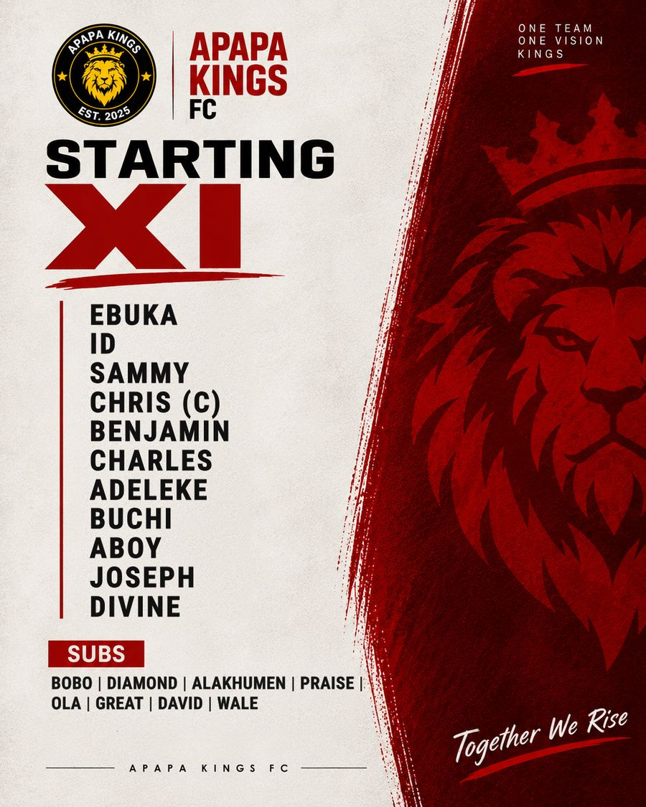

A tough afternoon in Ajegunle. Less than 24 hours after beating Skyworld FC 3–1, the Kings went down 6–2 away to Golden United FC at Nathaniel Idowu Stadium.

It's the heaviest defeat the Kings have suffered so far, and one the squad will want to put right quickly.

**Golden United FC 6–2 Apapa Kings FC**



Learn it, own it, come back harder.
